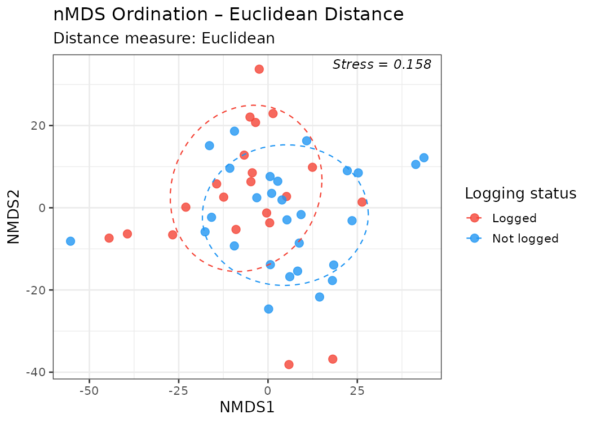
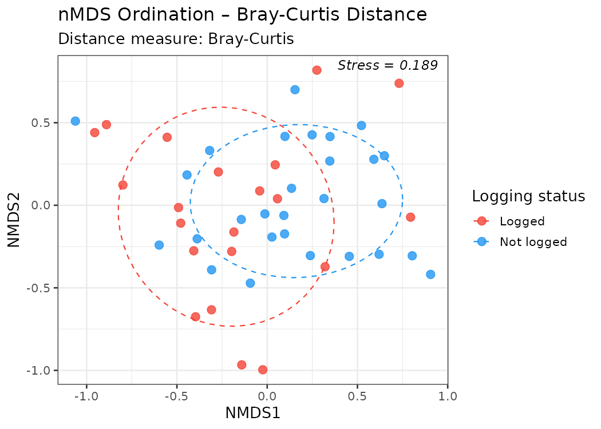
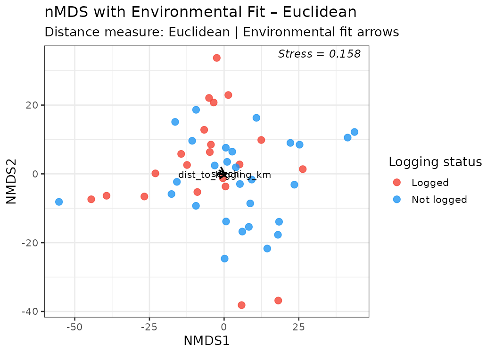
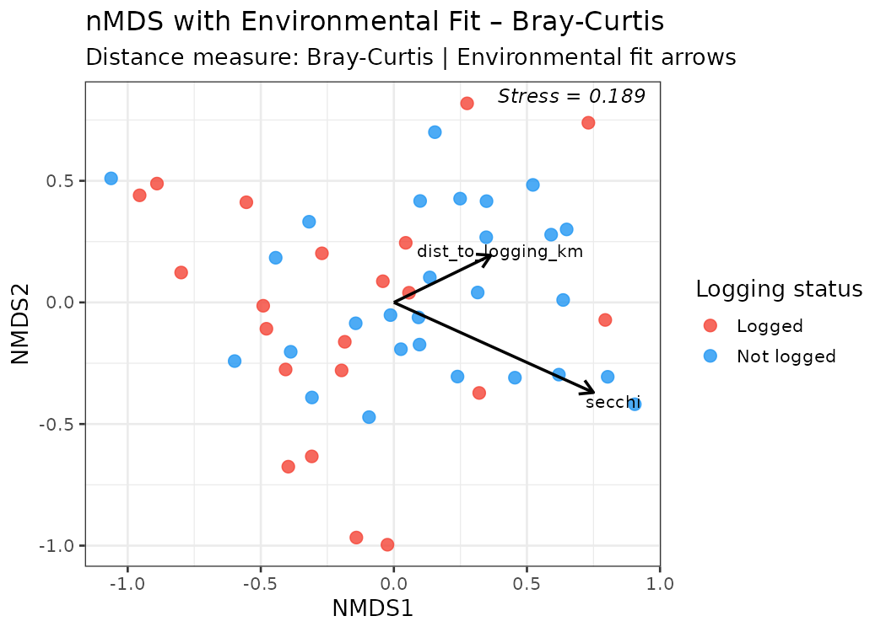

```{r setup, include=FALSE}
knitr::opts_chunk$set(echo = FALSE, message = FALSE, warning = FALSE,
                      fig.align = "center")
library(tidyverse)
library(vegan)
library(knitr)
```

## Introduction

This report analyses benthic cover surveys to visualise patterns in ecological
communities across reef sites in a region affected by logging. Non-metric
Multidimensional Scaling (nMDS) is used to reduce the dimensionality of the
benthic cover data and reveal underlying patterns in site dispersion. We are
particularly interested in how community structure relates to distance to
logging. Our hypothesis is that sedimentation caused by logging affects coral
cover.

The study design and dataset follow @brown2018.

---

## Data and Methodology

### Data collection

Benthic cover was recorded using the point intersect transect (PIT) method.
Divers swam along transects at each site. Along each transect they recorded
the benthic organism type at regular intervals. Percent cover for each category
was calculated as the number of points with that organism divided by the total
number of points on that transect. Multiple transects per site were averaged to
give a single percent cover value per site.

Site-level covariates — including distance to the nearest log pond
(`dist_to_logging_km`) and horizontal Secchi depth (`secchi`) — were sourced
from a companion dataset.

### Analytical approach

1. Benthic cover data were imported, categories joined to full names, and
   percent cover calculated per transect. Transects were then averaged to the
   site level.
2. Two dissimilarity matrices were computed from the site-level community
   matrix: **Euclidean** distance and **Bray-Curtis** dissimilarity.
3. Non-metric MDS (nMDS; `metaMDS` in the **vegan** package) was applied to
   each dissimilarity matrix to produce 2D ordinations. Stress values were
   evaluated as a diagnostic.
4. Environmental fitting (`envfit`) was used to project continuous
   environmental variables onto the ordination space and test their association
   with community structure.

---

## Results

### Data summary

```{r load-data}
site_benthic_wide <- read_csv("output/site_benthic_wide.csv", show_col_types = FALSE)
site_covariates   <- read_csv("output/site_covariates.csv",   show_col_types = FALSE)
stress_summary    <- read_csv("output/stress_summary.csv",    show_col_types = FALSE)
envfit_results    <- read_csv("output/envfit_results.csv",    show_col_types = FALSE)
```

The analysis included **`r nrow(site_benthic_wide)` sites** and
**`r ncol(site_benthic_wide) - 1` benthic categories**. Of the
`r nrow(site_covariates)` sites,
`r sum(site_covariates$logged == "Logged")` were classified as **Logged** and
`r sum(site_covariates$logged == "Not logged")` as **Not logged**.

---

### nMDS Stress Values

Stress quantifies how well the 2D ordination represents the true
multidimensional dissimilarities. Values < 0.10 indicate a good representation;
values between 0.10 and 0.20 are acceptable.

```{r stress-table}
stress_summary %>%
  mutate(stress = round(stress, 4)) %>%
  kable(col.names = c("Distance measure", "Stress", "Quality"),
        caption = "Table 1. nMDS stress values for each distance measure.")
```

Both ordinations fall in the **acceptable** range (stress < 0.20), indicating
that the 2D representation captures the main structure in the data, albeit with
some loss of information.

---

### nMDS Ordination – Euclidean Distance

```{r fig-nmds-euclidean, fig.cap="Figure 1. nMDS ordination based on Euclidean distance. Points are coloured by logging status. Dashed ellipses represent 68% confidence regions. Stress is shown in the top-right corner.", out.width="80%"}

```

The Euclidean nMDS (stress = `r round(stress_summary$stress[stress_summary$distance == "Euclidean"], 3)`)
shows a broad spread of sites in ordination space. There is partial separation
between logged and not-logged sites along the first ordination axis, suggesting
that logging is associated with differences in benthic community composition,
though the groups overlap substantially.

---

### nMDS Ordination – Bray-Curtis Distance

```{r fig-nmds-braycurtis, fig.cap="Figure 2. nMDS ordination based on Bray-Curtis dissimilarity. Same layout as Figure 1.", out.width="80%"}

```

The Bray-Curtis nMDS (stress = `r round(stress_summary$stress[stress_summary$distance == "Bray-Curtis"], 3)`)
produces a similar picture but with slightly higher stress, which is expected
given that Bray-Curtis captures relative abundance patterns and is therefore
more sensitive to compositional variability. The partial clustering by logging
status remains visible.

---

### Environmental Fit – Relationship to Logging and Water Clarity

```{r fig-envfit-euc, fig.cap="Figure 3. nMDS ordination (Euclidean) overlaid with envfit arrows for distance to logging and Secchi depth. Arrow length is proportional to the strength of the relationship.", out.width="80%"}

```

```{r fig-envfit-bc, fig.cap="Figure 4. nMDS ordination (Bray-Curtis) overlaid with envfit arrows.", out.width="80%"}

```

```{r envfit-table}
envfit_results %>%
  mutate(r2      = round(r2,      3),
         p_value = round(p_value, 3)) %>%
  kable(col.names = c("Distance measure", "Variable", "R²", "p-value"),
        caption = "Table 2. envfit results: relationship between environmental variables and benthic community structure (999 permutations).")
```

**Key findings from environmental fitting:**

- **Secchi depth** (a proxy for water clarity / turbidity) shows a strong and
  statistically significant relationship with community structure under both
  distance measures (Euclidean: R² = `r round(envfit_results$r2[envfit_results$variable == "secchi" & envfit_results$distance == "Euclidean"], 3)`,
  p = `r envfit_results$p_value[envfit_results$variable == "secchi" & envfit_results$distance == "Euclidean"]`;
  Bray-Curtis: R² = `r round(envfit_results$r2[envfit_results$variable == "secchi" & envfit_results$distance == "Bray-Curtis"], 3)`,
  p = `r envfit_results$p_value[envfit_results$variable == "secchi" & envfit_results$distance == "Bray-Curtis"]`).
  Sites with higher Secchi values (clearer water) tend to have distinctly
  different community compositions from turbid sites.

- **Distance to logging** does not show a statistically significant
  relationship with community structure (Euclidean: R² =
  `r round(envfit_results$r2[envfit_results$variable == "dist_to_logging_km" & envfit_results$distance == "Euclidean"], 3)`,
  p = `r envfit_results$p_value[envfit_results$variable == "dist_to_logging_km" & envfit_results$distance == "Euclidean"]`;
  Bray-Curtis: R² =
  `r round(envfit_results$r2[envfit_results$variable == "dist_to_logging_km" & envfit_results$distance == "Bray-Curtis"], 3)`,
  p = `r envfit_results$p_value[envfit_results$variable == "dist_to_logging_km" & envfit_results$distance == "Bray-Curtis"]`).
  This suggests that the linear distance to the nearest log pond alone does not
  predict community composition once spatial averaging to the site level is
  applied.

---

## Discussion

The nMDS ordinations reveal partial clustering of logged vs. not-logged sites,
consistent with logging having some effect on benthic community composition.
However, the overlap between groups and the non-significant `envfit` result for
`dist_to_logging_km` suggest that the relationship is not simply driven by
proximity to log ponds. This may reflect the complexity of sedimentation
dynamics, local hydrodynamics, or the coarser classification of sites as logged
vs. not logged.

Water clarity (Secchi depth) emerges as the strongest predictor of community
composition. This is ecologically plausible: turbid water reduces light
availability, favouring soft corals and macroalgae over hard corals, which
require high light levels for growth. Given that logging-induced sedimentation
increases turbidity, Secchi depth may be acting as a proximate mechanism
through which logging affects benthic communities.

### Limitations

- Stress values in the acceptable range (0.15–0.19) indicate some distortion in
  the 2D representation; caution is warranted when interpreting fine-scale
  patterns.
- The `envfit` analysis is based on linear correlations between environmental
  vectors and ordination scores; non-linear responses cannot be detected.
- Other unmeasured variables (reef exposure, depth, human disturbance) may
  confound the observed patterns.

---

## Conclusion

Benthic community composition varies across sites in a manner partially
associated with logging status. Water clarity is the strongest environmental
predictor of community structure, consistent with logging-induced sedimentation
altering light availability and thereby shifting community composition. Future
work should use multivariate regression tree or permanova approaches to
formally test the effects of logging and water clarity while accounting for
spatial autocorrelation.

---

## References

<div id="refs"></div>
